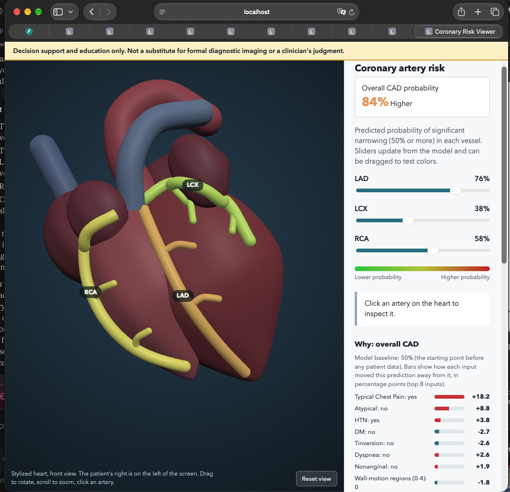

# Cardio Risk 3D: coronary artery risk visualization

Multimodal AI Hackathon 2026, Track A (Cardiovascular Risk Visualization & Prediction).

A web app that predicts overall coronary artery disease (CAD) and significant stenosis (50% or more narrowing) in the three main coronary arteries (LAD, LCX, RCA) from clinical data. It colors an interactive 3D heart by the predicted risk, and explains every prediction with SHAP, per-category totals, plain-language sentences, and a what-if check.

**What the percentages mean.** They are estimated probabilities of coronary disease among patients like those in the training data, whose disease status was confirmed by cardiac catheterization. They are diagnostic-style estimates, not forecasts of future risk.

> **Clinical safety disclaimer.** Predictions are for decision support and education only. They are not a substitute for formal diagnostic imaging or a clinician's judgment. This is a hackathon prototype, not a medical device.



## What it does

- **Prediction:** four classifiers (overall CAD, LAD, LCX, RCA) trained on the Extension of the Z-Alizadeh Sani dataset (303 patients), validated with nested cross-validation, and calibrated so percentages match observed rates.
- **3D heart (Three.js):** an anatomical heart with ventricles, atria, aorta, pulmonary trunk and vena cava. The LAD, LCX and RCA (with side branches) change color from green to red with the predicted probability. Rotate, zoom, and click any artery, chamber or vessel.
- **Explanations:** per-input SHAP bars, totals by category (symptoms, ECG, echo, blood tests and so on), a plain-language summary, and a what-if line, all computed on the server from fixed templates (no generated text).
- **Reliability badges and muted colors:** each vessel carries a badge from its cross-validated ROC-AUC ("strong", "moderate" or "modest signal"), and vessels with only a modest signal are drawn in muted colors, so weaker predictions are not presented with false confidence.
- **Honesty about inputs:** the result shows how many inputs differ from the typical (median) patient, because unchanged inputs are filled with dataset medians.
- **Illustrative cross-section:** selecting an artery shows a cutaway where plaque opacity reflects the predicted probability. It is explicitly labeled illustrative, since the dataset has no lesion measurements.
- **Patient form:** enter values or load an example. Impossible values are blocked, and values outside the training range raise a warning.

## Quick start

Requires Python 3.12 or newer (developed on 3.13.9) and an internet connection (Three.js loads from a CDN).

```bash
git clone https://github.com/trw7xx2nkx-del/cardio-risk-3d.git
cd cardio-risk-3d
./run.sh                      # creates .venv, installs requirements, starts the app
```

Or manually:

```bash
python3 -m venv .venv
source .venv/bin/activate     # Windows: .venv\Scripts\activate
pip install -r requirements.txt
uvicorn api:app --port 8000
```

Open http://localhost:8000. The trained models are included in `models/`, so no training is needed. `scikit-learn` is pinned because saved models only load reliably with the same version. API docs are at http://localhost:8000/docs.

Run the tests: `pip install -r requirements-dev.txt && python -m pytest -q` (9 tests: leakage prevention, data cleaning, API behavior, explanation consistency).

## Retraining from scratch

1. Download the *Extension of Z-Alizadeh Sani Dataset* from the UCI Machine Learning Repository and place the Excel file in `data/`.
2. Run, in order: `python train.py` (nested CV, models, figures), `python calibrate.py` (probability calibration), `python evaluate_extended.py` (baselines, subgroups, screening thresholds). Restart the server afterwards.

## Method

**Data.** 303 patients with demographic, examination, ECG, laboratory and echocardiography features. Targets: overall CAD (`Cath`) and stenosis of LAD, LCX, RCA.

**Preprocessing** (`preprocess.py`, shared by training and serving so they cannot drift apart): `LAD`, `LCX`, `RCA` and `Cath` are always removed from the inputs (target leakage prevention, enforced by tests). Yes/No columns become 0/1, `VHD` is ordinal, `BBB` becomes two indicators, and the constant column `Exertional CP` is dropped. 55 input features remain, with no missing values.

**Models and validation.** For each target, random forest and extra trees were compared with **nested cross-validation**: the outer 5 folds estimate performance, and hyperparameters (`min_samples_leaf`, `max_features`, `class_weight`) are tuned by an inner 3-fold search that only sees each fold's training data. Confidence intervals come from 1,000 bootstrap resamples. The best family per target was refit on all data and deployed: extra trees for CAD and RCA, random forest for LAD and LCX.

**Calibration.** Tree ensembles produced compressed probabilities (observed rates were more extreme than predicted). Platt scaling fitted on cross-validated predictions corrects this; its benefit was measured with a second round of cross-validation. See `docs/figures/calibration_before_after.png`.

**Explanations.** `shap.TreeExplainer` gives per-patient contributions, rescaled so the bars add up to the displayed (calibrated) prediction minus the calibrated baseline. Sentences are template-based, and the what-if re-runs the model with one changed input. It describes the model's behavior and is not medical advice or a causal claim.

**Serving.** FastAPI (`api.py`): `GET /api/meta` and `POST /api/predict`. Inputs the user does not change are filled with the dataset median.

## Results

Nested 5-fold cross-validation, threshold 0.5, 95% bootstrap interval for ROC-AUC:

| Target | Model | Accuracy | Precision | Recall | F1 | ROC-AUC (95% CI) | Brier (raw -> calibrated) |
|---|---|---|---|---|---|---|---|
| Overall CAD | Extra trees | 0.865 | 0.911 | 0.898 | 0.904 | 0.911 (0.872-0.948) | 0.110 -> 0.096 |
| LAD | Random forest | 0.779 | 0.786 | 0.853 | 0.818 | 0.855 (0.809-0.896) | 0.168 -> 0.155 |
| LCX | Random forest | 0.660 | 0.614 | 0.361 | 0.455 | 0.723 (0.666-0.773) | 0.202 -> 0.200 |
| RCA | Extra trees | 0.657 | 0.558 | 0.421 | 0.480 | 0.728 (0.673-0.783) | 0.211 -> 0.205 |

**Against simple baselines** (ROC-AUC; `docs/baselines.csv`):

| Target | Typical chest pain alone | 7 basic risk factors (logistic) | Our model |
|---|---|---|---|
| CAD | 0.799 | 0.905 | 0.911 |
| LAD | 0.732 | 0.791 | 0.855 |
| LCX | 0.649 | 0.749 | 0.723 |
| RCA | 0.650 | 0.737 | 0.728 |

The tree models clearly beat the simple baseline only for the LAD. For overall CAD the gain is negligible, and for LCX and RCA the basic logistic regression is as good or slightly better. A blend of both models gained about 0.017 AUC on LCX and RCA, but was not adopted because it would make the SHAP explanations inexact.

**Screening-style operating points** (threshold chosen on training folds, evaluated on held-out folds; `docs/screening_thresholds.csv`): aiming at 90% sensitivity gives CAD sensitivity 0.89 with specificity 0.83. For LCX and RCA the same target gives specificity of only about 0.41, which is why those two vessels are flagged as weak signals.

**Subgroups** (`docs/subgroups.csv`, `docs/figures/subgroup_auc.png`): performance is similar for women and men for CAD and LAD. LAD, LCX and RCA weaken in patients aged 60 and older, with wide intervals because the groups are small.

Other figures in `docs/figures/`: `roc.png`, `confusion.png`, `calibration.png`, and `shap_CAD.png`, `shap_LAD.png`, `shap_LCX.png`, `shap_RCA.png`.

## How this fits the track

Track A asks for a system that combines structured clinical data from several sources (demographics and symptoms, ECG findings, echocardiography findings, laboratory values) into predictions, and presents them through a 3D anatomical model, charts and text explanations. This project follows that brief. It does not process raw images, signals or audio.

## Privacy

Entered values are sent to the server only to compute the prediction. The app does not store or log them, but the hosting provider keeps standard request logs. This is a demo: please do not enter real patient information.

## Limitations

- **Small, single-source dataset.** 303 patients and no external validation. Results may not generalize to other hospitals or populations.
- **Selected patient group.** 71% of the patients have CAD, so percentages answer "how often was CAD found among patients like these?" and not "what is this person's risk in the general population?" Predictive values (PPV and NPV) would differ elsewhere.
- **LCX and RCA are weak.** ROC-AUC is about 0.72, a simple logistic regression does as well, and catching 90% of cases means flagging many healthy vessels. Treat these two colors as weak signals.
- **Colors show vessel-level model output, not lesion location.** The dataset has no spatial labels. The heart is a stylized anatomical model, and the cross-section is illustrative.
- **Baselines differ by target** because some selected models use balanced class weights and others do not. Calibration moves them toward the data's real rates.
- **Model selection is mildly optimistic** because the best of two families was chosen on the same outer folds. Nested validation removes this for tuning, but not for this last choice.
- **SHAP shows associations, not causes,** and the blood-test contributions for LCX and RCA are small and may be noise at this sample size.
- **Median defaults.** Inputs left unchanged are filled with the dataset median, and example patients in the dropdown come from the training data (demonstration only).

## Repository layout

```
api.py                    FastAPI server (predictions, SHAP, plain-language text)
preprocess.py             Shared data cleaning
train.py                  Nested-CV training, models, figures
calibrate.py              Probability calibration
evaluate_extended.py      Baselines, subgroups, screening thresholds
run.sh                    One-command start
requirements.txt, requirements-dev.txt
models/                   Trained models, calibration, feature metadata
web/index.html            3D viewer and dashboard (Three.js)
tests/                    Automated tests
notebooks/01_explore.ipynb  Exploration and early experiments
docs/                     Figures and metric tables
```

## Data, licenses and credits

- Dataset: Extension of the Z-Alizadeh Sani Dataset, UCI Machine Learning Repository. TODO: paste the dataset's citation and license text from its UCI page here.
- 3D rendering: [Three.js](https://threejs.org) (MIT), loaded from a CDN. The heart geometry is generated in code, and no third-party 3D model is used.
- Libraries: scikit-learn, SHAP, FastAPI, pandas, NumPy, Matplotlib.
